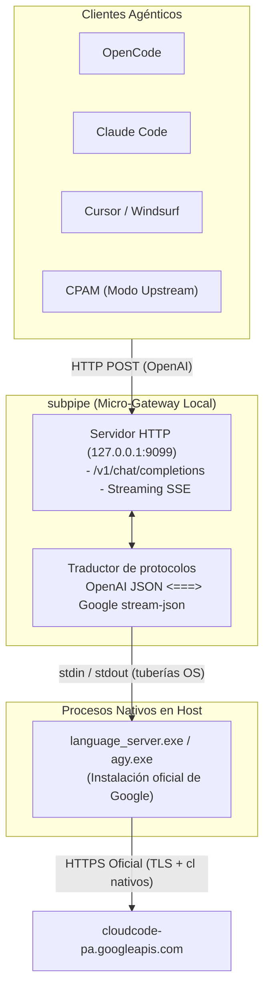

# subpipe: Arquitectura de puente por subproceso local para Antigravity

Documento de diseño técnico para desacoplar clientes agénticos (OpenCode, Claude Code, Cursor) de los bloqueos `403 TOS_VIOLATION` en `cloudcode-pa.googleapis.com`.

---

## El problema real: por qué caen las cuentas con proxies tradicionales

Cuando usas herramientas como CLIProxyAPI o CPAMC para conectar agentes de código a Gemini o Claude mediante las cuentas de Antigravity, la caída es predecible: un error `HTTP 403 PERMISSION_DENIED` con la etiqueta `TOS_VIOLATION`.

El motivo no es que Google tenga operadores vigilando tus prompts uno a uno, sino que los proxies HTTP tradicionales intentan simular ser el cliente oficial a base de ingeniería inversa en internet. Esa simulación tiene costuras evidentes para el WAF de Google:

1. **El desfase del changelist en `User-Agent`:**  
   Google actualiza Antigravity cada pocas semanas (ej. versión `2.29.0`). Cada versión exige un número de compilación interno de Piper en la cabecera (algo como `; cl=1013060670`). Si el proxy no tiene ese hash exacto compilado en una tabla interna, manda una cabecera truncada. Para el balanceador de Google, un cliente sin ese hash o con un hash viejo es tráfico sintético inmediato.
2. **Firmas de herramientas en texto plano:**  
   Clientes como OpenCode o Claude Code mandan su identidad en los mensajes de sistema o en el contexto de archivo (`"OpenCode agent"`, `<system-conventions>`, fragmentos de `AGENTS.md`). Los filtros de inspección de paquetes marcan esas cadenas sin esfuerzo.
3. **Pérdida de afinidad de sesión (*Session Hopping*):**  
   Un proxy con balanceo round-robin le tira el turno 1 de una tarea a la Cuenta A, el turno 2 a la Cuenta B y el turno 3 a la Cuenta C. Ver cómo tres cuentas reciben el mismo prompt acumulado de 280 KB con diez segundos de diferencia desde una misma IP doméstica es una firma inequívoca de proxy compartido.
4. **Comportamiento TCP no humano:**  
   El cliente oficial mantiene una o dos conexiones HTTP/1.1 persistentes abiertas con keep-alive. Muchos proxies abren un socket TCP nuevo, negocian TLS y lo destruyen en cada mensaje individual.

---

## Dos enfoques actuales y sus límites

| Parámetro | Proxy Reverso (CPAMC / CLIProxyAPI) | Subproceso Oficial (EstebanForge / Pi Bridge) |
| :--- | :--- | :--- |
| **Punto de conexión a Google** | Conexión HTTPS directa creada por el proxy. | Conexión HTTPS abierta por el binario oficial (`language_server.exe`). |
| **Firma TLS y cabeceras** | Simuladas por código de terceros. Frágil ante cambios. | 100% nativa. El ejecutable oficial maneja sus propios certificados y changelists. |
| **Compatibilidad** | Universal: expone `/v1/chat/completions` (OpenAI). | Restringida: atada exclusivamente al agente Pi (`pi.dev`). |
| **Manejo de cuentas** | Centralizado en un panel, pero con riesgo de mezcla. | Monocuenta: corre con el perfil activo de la máquina. |

El proxy tradicional tiene la interfaz correcta pero el motor de red equivocado. El experimento de EstebanForge para Pi tiene el motor de red correcto (inmune a detección), pero está encerrado en un único cliente y en una sola cuenta.

---

## Qué es `subpipe`

`subpipe` es un micro-adaptador local que toma la interfaz universal del proxy y el transporte blindado del subproceso:



### Principio operativo

1. `subpipe` levanta un puerto local (por defecto `127.0.0.1:9099`) y atiende peticiones en `/v1/chat/completions`.
2. Hacia afuera, `subpipe` **no abre ninguna conexión de red hacia Google**. 
3. Lanza en segundo plano el ejecutable oficial (`language_server.exe` o `agy`) y se conecta a él a través de sus tuberías estándar del sistema operativo (`stdin` y `stdout`).
4. Cuando OpenCode envía un prompt, `subpipe` traduce el JSON de OpenAI al protocolo interno que espera el binario (`stream-json` / ACP) y lo escribe en `stdin`.
5. El binario de Google abre la conexión de red legítima, con su propio pool TLS, su changelist válido y su firma oficial de sistema operativo.
6. La respuesta que el binario devuelve por `stdout` es procesada por `subpipe` y reenviada como un flujo SSE estándar al cliente.

---

## Rompiendo el confinamiento de Pi: compatibilidad abierta

El puente original de EstebanForge no tenía capa de red; Pi hablaba directo por tuberías con el binario. `subpipe` mete en medio un traductor que expone la API de OpenAI, lo que permite que cualquier herramienta con soporte para endpoints personalizados funcione sin parches:

* **OpenCode:** Configurar `baseUrl: "http://127.0.0.1:9099/v1"`.
* **Claude Code:** Conectar mediante proxy local o apuntando al upstream.
* **Cursor / Windsurf:** En ajustes de modelos, sobrescribir *OpenAI Base URL*.
* **Cline / Roo Code:** Seleccionar proveedor *OpenAI-Compatible*.
* **Aider:** Ejecutar con `--openai-api-base http://127.0.0.1:9099/v1`.

---

## Integración con CPAM: ¿Plugin interno o servicio satélite?

Intentar meter esta lógica como un archivo `.so` en la carpeta `plugins/` de CPAM no funciona en este entorno por tres razones prácticas:

1. **Docker vs Host Windows:** CPAM corre habitualmente dentro de un contenedor Linux (`eceasy/cli-proxy-api:latest`). La instalación de Antigravity, sus credenciales y su ejecutable (`language_server.exe`) están en el Windows anfitrión. Un plugin dentro del contenedor Docker no puede invocar de forma limpia binarios del host.
2. **Precedencia en CLIProxyAPI:** El proveedor `antigravity` ya está compilado de forma nativa en el código fuente de CPAM. Su arquitectura estipula que los ejecutores nativos tienen prioridad sobre los plugins.
3. **Rigidez de CGO:** Compilar plugins dinámicos de Go para Windows es frágil y poco mantenible.

### Cómo encaja `subpipe` con CPAM

Hay dos caminos de uso:

#### 1. Como Upstream Provider (Conservando el panel CPAMC)
Si te interesa mantener el panel web de CPAMC, las métricas de uso y el recuento de tokens:
`subpipe` corre en Windows. En el `config.yaml` de CPAM, agregas un canal compatible con OpenAI que apunta a `subpipe`:

```yaml
# En config.yaml de CPAM
openai-compatibility:
  - name: "subpipe-antigravity"
    base-url: "http://host.docker.internal:9099/v1"
    api-key: "local-dev-key"
    models:
      - name: "gemini-3.8-pro"
      - name: "gemini-3.8-flash"
```

CPAM recibe la llamada del cliente, registra el consumo en su interfaz y se la delega a `subpipe`. Quien habla con Google sigue siendo el binario oficial.

#### 2. Modo directo (Bypass sin Docker)
Apuntas OpenCode o Cursor directamente a `http://127.0.0.1:9099/v1`. Te ahorras levantar contenedores Docker, reintentos agresivos y refrescos automáticos de tokens. CPAM queda reservado únicamente para otros proveedores (Claude oficial, OpenAI, DeepSeek).

---

## Gestión multicuenta y aislamiento con multiplexores (tipo Herdr)

Manejar varias cuentas de Google no debe resolverse metiendo 10 tokens en un balanceador round-robin que los mezcle en la misma tarea.

Para trabajar con varias cuentas sin activar alertas:

1. **Aislamiento de perfiles en disco:**  
   El binario oficial admite aislar perfiles mediante variables de entorno (`USERPROFILE`) o directorios dedicados:
   * Perfil A: `~/antigravity_profiles/cuenta_1`
   * Perfil B: `~/antigravity_profiles/cuenta_2`
2. **Afinidad física de sesión:**  
   En Herdr o multiplexor de terminales, cada espacio de trabajo corre su propia instancia de `subpipe` con su perfil asignado. La tarea que vive en el Espacio 1 solo toca la Cuenta A. No hay salto de sesión posible.
3. **Git Worktrees para trabajo concurrente:**  
   Si dos cuentas necesitan modificar el mismo repositorio al mismo tiempo, el multiplexor levanta un worktree independiente para cada una (`git worktree add ../repo_featA feature/A`), evitando colisiones de archivos en disco.

---

## Cuidados de red para flotas de cuentas

* **Usa la IP residencial:** Salir a través de VPS o VPNs comerciales baja drásticamente la tolerancia del WAF de Google.
* **Tope de concurrencia:** No envíes ráfagas de generación de más de 2 o 3 cuentas simultáneas al mismo segundo. Tres agentes trabajando en paralelo se ven como actividad humana normal en una casa o estudio; ocho agentes simultáneos disparan límites de tasa por IP.
* **Jitter en comprobaciones:** Si implementas verificación de cuotas, desincroniza los intervalos para que no consulten todas las cuentas al mismo segundo exacto.

---

## Fases de construcción

1. **Fase 1 (Micro-Gateway básico):**  
   Servidor local en Go o Node.js que escuche en `/v1/chat/completions`, levante `language_server.exe` por `exec.Command` / `child_process.spawn` y canalice prompts por `stdin` devolviendo SSE por `stdout`.
2. **Fase 2 (Validación con clientes):**  
   Conexión con OpenCode y prueba de canal upstream en `config.yaml` de CPAM.
3. **Fase 3 (Multicuenta y perfiles):**  
   Scripts de lanzamiento con variables de entorno de perfil separadas para integrar en espacios de Herdr.
4. **Fase 4 (Monitor de cuotas):**  
   Lectura de estado de cuota y cambio limpio de tarea entre espacios.
